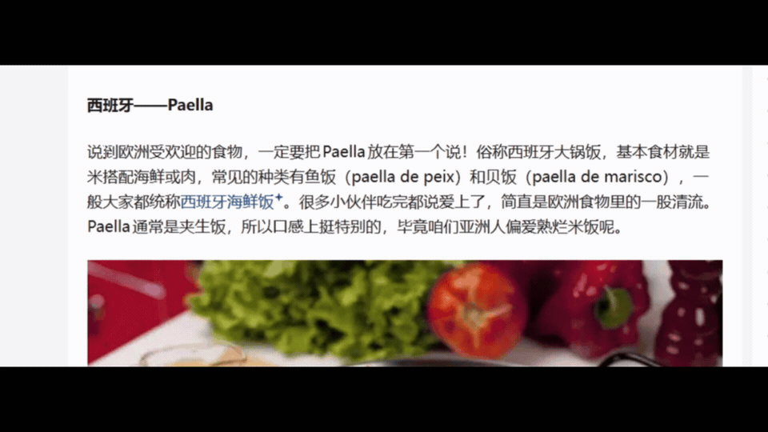
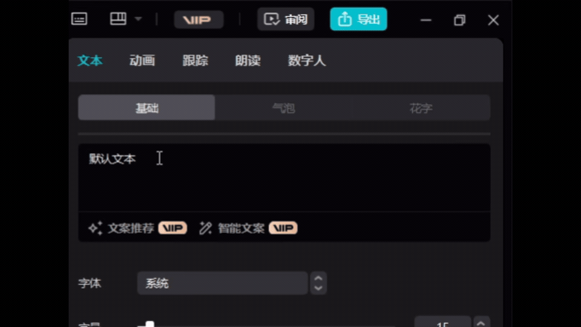

# 粤语拼音弹窗（Jyutping Popup）

划选中文，立刻在光标旁弹出每个字的粤语拼音（Jyutping）；遇到无法高亮的图片、PDF 扫描件或视频画面，还能手动「截图识字」，离线识别中文再逐字注音。常驻系统托盘，零干扰。

Select Chinese text and a popup shows the Jyutping (Cantonese romanization) for each character right next to the cursor. For content you cannot highlight, such as images, scanned PDFs, or video frames, trigger "screenshot OCR" to recognize Chinese offline and annotate it character by character. Runs quietly in the system tray.

## 演示 / Demo

三段实机演示动图，覆盖网页文章、桌面编辑器和图片搜索页，同时展示「划词注音」与「截图识字」两条取词路径。

Three short demo GIFs covering a web article, a desktop editor, and an image search page, showing both the selection popup and the screenshot OCR path.

### 网页文章（知乎）/ Web article (Zhihu)



在普通网页里直接选中中文，卡片立刻出现在选区旁，逐字标出粤拼。

Select Chinese in a normal web page and the card appears next to the selection with per character Jyutping.

### 剪映 / CapCut



深色桌面程序里同样可用，不依赖浏览器或网页文本接口。

Works the same in a dark themed desktop app, with no dependency on a browser or web text APIs.

### Google 图片搜索 / Google image search


图片里的字选不中时，按 `Ctrl + Shift + L` 拖框圈住，离线 OCR 识别后再逐字注音；按 `Esc` 或点提示条右侧的 `✕` 可取消。

When text sits inside an image and cannot be selected, press `Ctrl + Shift + L` and drag a box around it. Offline OCR reads the text and annotates each character. Press `Esc` or click the `✕` next to the hint bar to cancel.

演示动图由 `assets/Video/make_gif.bat` 生成：把本地录屏拖到脚本上即可批量转换，统一输出 960×540、12fps、循环播放的 GIF。仓库只保留 GIF，源录屏不上传。

The demo GIFs come from `assets/Video/make_gif.bat`. Drag a local recording onto the script to batch convert it into 960x540, 12fps, looping GIFs. Only the GIFs are committed; source recordings are excluded.

## 功能特性 / Features

- **划词注音**：在任意程序里选中一段中文，自动弹出小卡片，汉字在上、粤拼在下，多音字会在底部单独列出。
- **截图识字**：按热键或点托盘菜单，拖框选中屏幕上的任意区域，离线识别其中文并注音。适合图片、截图、扫描件等无法高亮的场景。
- **自定义热键**：三个热键均可改，也可一键恢复默认：退出 `Ctrl + Shift + Q`、暂停 `Ctrl + Shift + P`、截图识字 `Ctrl + Shift + L`。
- **多音字与词优先**：先按词查表（如「重量」读 `cung5 loeng6`），查不到再回退到单字，避免把词劈开读错。
- **简繁转换**：注音前自动把简体转成香港繁体，字形与粤拼表一致。
- **单实例**：重复启动只会唤醒已运行的实例，不会开多个。
- **托盘常驻**：右键托盘图标可显示主界面、暂停/继续捕获、截图识字或退出；可设开机自启。

- **Selection popup:** Select Chinese in any app and a card appears automatically, with the character on top and its Jyutping below. Polyphonic characters are listed at the bottom.
- **Screenshot OCR:** Press the hotkey or use the tray menu, drag a box around any screen region, and the Chinese text is recognized offline and annotated. Good for images, screenshots, and scans that cannot be highlighted.
- **Customizable hotkeys:** All three hotkeys can be changed or reset to defaults: quit `Ctrl + Shift + Q`, pause `Ctrl + Shift + P`, screenshot OCR `Ctrl + Shift + L`.
- **Words before characters:** Multi-character words are looked up first (for example 「重量」 reads `cung5 loeng6`), falling back to single characters only when needed, so words are not split incorrectly.
- **Simplified to Traditional:** Text is converted to Hong Kong Traditional before annotation, matching the shapes in the Jyutping tables.
- **Single instance:** Launching again only wakes the running instance instead of opening another.
- **System tray:** Right click the tray icon to show the main window, pause or resume capture, trigger screenshot OCR, or quit. Optional launch on startup.

## 使用方法 / Usage

### 系统要求 / Requirements

- Windows 10 / 11（系统版本 22621 或更高，OCR 需要此版本以上的 WinRT 接口）
- .NET 9 运行时（若用自包含发布则不需要）

- Windows 10 / 11 (OS build 22621 or later, required by the WinRT OCR APIs)
- .NET 9 runtime (not needed for a self contained publish)

### 安装 / Install

从 Release 下载安装包，或用 Inno Setup 打开 `installer/JyutPingPopup.iss` 按 `F9` 编译出 `setup.exe` 安装。也可直接运行从源码发布的单文件 `JyutPingPopup.exe`。

Download the installer from Release, or open `installer/JyutPingPopup.iss` in Inno Setup and press `F9` to compile `setup.exe`. You can also run the single file `JyutPingPopup.exe` published from source.

### 日常使用 / Daily use

1. 在浏览器、文档、聊天窗口里**选中一段中文**，卡片会自动出现在选区旁。
2. 想读图片里的字：按 `Ctrl + Shift + L`（或托盘菜单「截图识字」），拖框选中含中文的区域，松手即识别并弹注音面板；按 `Esc` 或点提示条右侧的 `✕` 取消。
3. 收起卡片：点击任意位置，或按 `Esc` / `Backspace` / `Delete` / `Enter`。
4. 改热键或设置：托盘菜单「显示主界面」。

1. **Select Chinese** in a browser, document, or chat window and the card appears next to the selection.
2. To read text in an image: press `Ctrl + Shift + L` (or the tray menu "截图识字"), drag a box around the Chinese region, release to recognize, and a panel shows the annotation. Press `Esc` or click the `✕` next to the hint bar to cancel.
3. Dismiss the card by clicking anywhere, or pressing `Esc` / `Backspace` / `Delete` / `Enter`.
4. Change hotkeys or settings from the tray menu "显示主界面".

## 截图识字的工作原理 / How screenshot OCR works

触发后，工具先拍一张全屏快照作为遮罩背景（在遮罩窗口显示之前拍，避免把自己拍进去），再叠一层变暗层和蓝色选框。你拖框选中的区域会被裁出来，交给系统离线的 WinRT 中文 OCR 引擎识别，识别出的文字经简繁转换后逐字查粤拼表，最后在浮层面板里逐字展示。整条链路**不联网、不依赖云服务**。

On trigger the tool first captures a full screen snapshot as the overlay background (taken before the overlay window shows, so it does not capture itself), then layers a dim mask and a blue selection box. The dragged region is cropped and handed to the system's offline WinRT Chinese OCR engine. The recognized text is converted to Traditional and looked up in the Jyutping tables character by character, then shown in a floating panel. The whole pipeline is **offline with no cloud dependency**.

## 技术栈 / Tech Stack

核心是一个 Windows 桌面程序，下面是各部分的作用简览。

The core is a Windows desktop app. The roles of each part are summarized below.

- **C# / WPF / .NET 9** (`net9.0-windows10.0.22621.0`): 渲染浮窗、设置窗口与截图遮罩的桌面 UI 框架。
- **WinRT `Windows.Media.Ocr`**: 离线、设备端的中文（`zh-Hans`）文字识别，不联网。
- **FlaUI.UIA3 5.0.0**: UI Automation 库，用于从大多数程序读取当前选区文字，无需碰剪贴板。
- **低层 Win32 钩子**: 全局鼠标与键盘钩子，用于选区检测与可自定义热键。
- **Rime 粤拼词典** (`data/chars.dict.yaml`, `data/words.dict.yaml`): 驱动汉字到粤拼的映射，先词后字。
- **OpenCC** (`data/opencc`): 注音前把简体转成香港繁体。
- **剪贴板备份与还原**: 对不支持 UI Automation 的程序作为安全兜底，原剪贴板内容始终还原。
- **Inno Setup** (`installer/JyutPingPopup.iss`): 生成 Windows 安装包。

- **C# / WPF / .NET 9** (`net9.0-windows10.0.22621.0`): Desktop UI framework that renders the floating popup, settings window, and screenshot overlay.
- **WinRT `Windows.Media.Ocr`**: Offline, on device Chinese (`zh-Hans`) text recognition with no network.
- **FlaUI.UIA3 5.0.0**: UI Automation library used to read the current selection from most apps without touching the clipboard.
- **Low level Win32 hooks**: Global mouse and keyboard hooks for selection detection and customizable hotkeys.
- **Rime Jyutping dictionaries** (`data/chars.dict.yaml`, `data/words.dict.yaml`): Drive the character to Jyutping mapping, words before characters.
- **OpenCC** (`data/opencc`): Converts Simplified Chinese to Hong Kong Traditional before annotation.
- **Clipboard backup and restore**: A safe fallback for apps without UI Automation, always restoring the original clipboard.
- **Inno Setup** (`installer/JyutPingPopup.iss`): Builds the Windows installer.

## 从源码构建 / Build from source

```bash
cd csharp
dotnet publish -c Release -p:PublishSingleFile=true --self-contained false -r win-x64 -o publish
```

构建产物在 `csharp/publish/JyutPingPopup.exe`。安装包用 Inno Setup 打开 `installer/JyutPingPopup.iss` 按 `F9` 编译（机器上通常没有命令行 `iscc`）。

The output is `csharp/publish/JyutPingPopup.exe`. For the installer, open `installer/JyutPingPopup.iss` in Inno Setup and press `F9` (the command line `iscc` is usually not installed).

## 自测 / Self-tests

仓库内置多套命令行自测，覆盖注音、剪贴板兜底、含图剪贴板持锁、卡片布局、OCR、截图遮罩与结果面板。其中 `--selftest-region` 和 `--selftest-ocrpanel` 会短暂弹出真实窗口，其余均为纯命令行：

```bash
JyutPingPopup.exe --selftest            # 注音对基线（20 样本）
JyutPingPopup.exe --selftest-clip       # 剪贴板兜底
JyutPingPopup.exe --selftest-cliprace   # 剪贴板竞态（用户内容不会丢失）
JyutPingPopup.exe --selftest-clipimage  # 含图剪贴板的持锁时长与内容安全
JyutPingPopup.exe --selftest-footer     # 多音字脚注布局
JyutPingPopup.exe --selftest-ui         # 卡片渲染
JyutPingPopup.exe --selftest-ocr        # 离线 OCR 识别
JyutPingPopup.exe --selftest-region     # 截图遮罩渲染与坐标
JyutPingPopup.exe --selftest-ocrpanel   # OCR 结果面板渲染
```

The repo ships several command line self tests covering annotation, clipboard fallback, image clipboard lock timing, card layout, OCR, the screenshot overlay, and the result panel. `--selftest-region` and `--selftest-ocrpanel` briefly open real windows; the rest are pure command line:

```bash
JyutPingPopup.exe --selftest            # annotation against baseline (20 samples)
JyutPingPopup.exe --selftest-clip       # clipboard fallback
JyutPingPopup.exe --selftest-cliprace   # clipboard race (user content is never lost)
JyutPingPopup.exe --selftest-clipimage  # clipboard lock duration with an image present
JyutPingPopup.exe --selftest-footer     # polyphonic footnote layout
JyutPingPopup.exe --selftest-ui         # card rendering
JyutPingPopup.exe --selftest-ocr        # offline OCR recognition
JyutPingPopup.exe --selftest-region     # screenshot overlay rendering and coordinates
JyutPingPopup.exe --selftest-ocrpanel   # OCR result panel rendering
```

## 文件结构 / Project layout

```
jyutping-popup/
  csharp/                  C# 源码（WPF 主程序、钩子、OCR、自测）
  data/                    粤拼词典与 OpenCC 数据（第三方，见 THIRD_PARTY_NOTICES.md）
  assets/                  图标与演示素材
  assets/Video/            演示 GIF 与 make_gif.bat 生成脚本
  installer/               Inno Setup 安装脚本
  README.md                项目说明
  LICENSE                  MIT 许可（仅覆盖本项目源码）
  THIRD_PARTY_NOTICES.md   第三方数据的许可与归属
```

```
jyutping-popup/
  csharp/                  C# source (WPF host, hooks, OCR, self tests)
  data/                    Jyutping dictionaries and OpenCC data (third party, see THIRD_PARTY_NOTICES.md)
  assets/                  Icons and demo assets
  assets/Video/            Demo GIFs and the make_gif.bat converter
  installer/               Inno Setup script
  README.md                This file
  LICENSE                  MIT license (project source only)
  THIRD_PARTY_NOTICES.md   Licenses and attribution for third-party data
```

词典逻辑或取词流程改动后，建议跑对应的 `--selftest` 对照基线再发布。

After changing dictionary logic or the capture flow, run the matching `--selftest` against the baseline before publishing.

## 许可 / License

本项目源码与文档依 [MIT](LICENSE) 许可发布。`data/` 目录收录的粤拼词典（CC BY 4.0）与 OpenCC 转换表（Apache-2.0）是第三方数据，**不适用 MIT**，其归属与许可见 [THIRD_PARTY_NOTICES.md](THIRD_PARTY_NOTICES.md)。

The project source and docs are released under the [MIT](LICENSE) license. The Jyutping dictionaries (CC BY 4.0) and OpenCC tables (Apache-2.0) under `data/` are third-party data and are **not covered by MIT**. See [THIRD_PARTY_NOTICES.md](THIRD_PARTY_NOTICES.md) for attribution and license details.
